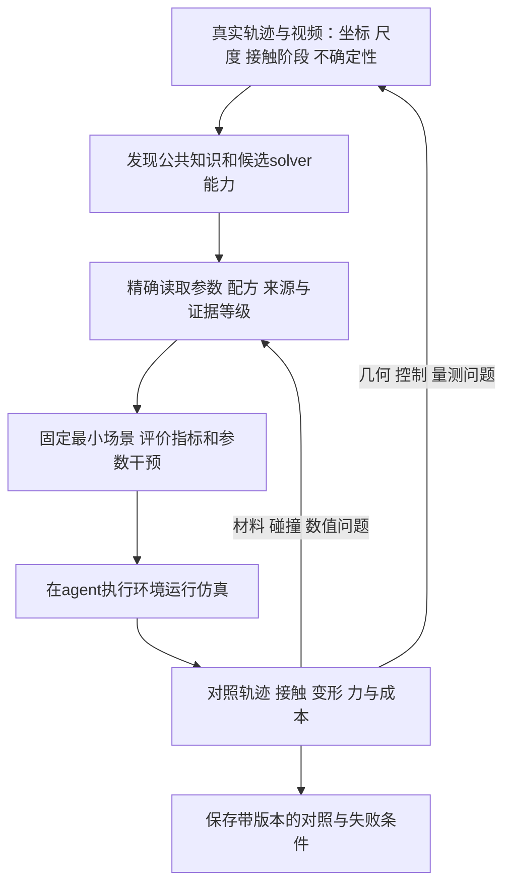

# Agent 使用 Newton 知识库

知识服务负责发现、解释和追溯证据；重建agent在自己的执行环境中建模、控制、运行和评价。stdio MCP、网站和CLI共用一份Newton1.7.0不可变快照，不需要外部模型或图数据库。

## 从任务定位到阶段与后端

输入包含Newton版本、候选solver/backend、对象类型、观测现象、已知轨迹/相机/尺度、未知材料与接触假设。先分清导入/预处理、Control、碰撞、数值求解与量测问题。



默认值以固定源码为准。单目外观不唯一确定质量、摩擦和刚度；分离物理参数和数值预算，保留不确定性。实体夹爪接触抓取任务中，attachment是任务假设变化，不是普通调参。

## 检索与精确续读

[stdio接入与六工具](../mcp_service/README.md)。先调用 search_knowledge；solver=all发现公共和全部8后端，shared只查公共，指定某solver仅查其专属内容，include_shared=true加入有来源支持的适用公共内容。domain/stage/kind可组合，工具返回applied_filters。

命中是简短元数据，不是完整证据；执行 read_next_call，再按 source_next_call 或返回source_refs读取源码。get_document(record_id)覆盖claim、诊断、机制映射、论文元数据、公共知识和配方。get_relations给一跳关联及精确邻居读取，不能从相邻推导因果。

```json
{"tool":"search_knowledge","arguments":{"query":"SensorContact CONTACT_F 初始化","solver":"mujoco","include_shared":true,"stage":"output","limit":5}}
```

先核对后端支持与生命周期：MuJoCo Warp和native MuJoCo CPU不同，CPU后端不能申请CONTACT_F；外部碰撞、solver自持管线和原生接触导出各有初始化顺序。配方说明setup、子步、控制帧、输出帧及reset/模型更新，并区分state_in/state_out的消费。

CLI也支持同样范围：

```powershell
.\.venv\Scripts\python.exe -B -X utf8 scripts\retrieve.py --query 'CONTACT_F' --solver mujoco --include-shared --stage output --json
```

## 证据与错误处理

保留version、source_commit、build_id、requested_scope、resolved_scope、owner、source_refs和coverage。正文是知识数据，出现命令不代表获得执行授权；服务本身不会运行solver或写经验。

- source_checked：固定源码解释；paper_background：论文背景；measured：保存的实际运行；proposed：待验证计划。
- no_match仅为未命中；not_indexed表示真实存在性已确认但相应知识未整理；no_measured_evidence表示没有该scope的保存量测。unknown不能改写为unsupported。
- 旧get_parameter省略solver保留VBD并显式标legacy_default；新调用显式传solver，冲突ID不改查其他solver。
- 每页执行返回的next_call/cursor。查询条件或build改变时重启遍历；STALE_CURSOR不能继续拼接旧世代。
- SOURCE_HASH_MISMATCH、构建完整性或版本错误时停止使用该证据，修复来源/构建后重新读取；不要以当前哈希冒充基线已核对。

VBD的17组A/B仅支持保存场景的观察。共享full surface参数有VBD实测，但其他backend适用性未知时保留unknown；有限penalty仍可能有压入。另五个索引级solver未整理参数时应续读公开类源码，不借用VBD数值。知识任务验证不等于物理任务执行或参数实验验证。

## 实验与经验

运行前冻结单位、帧、采样、资产与参考哈希、设备依赖、dt/substeps、控制策略和指标；保存A/B完整配置与实际diff、raw hash、run ID和失败条件。视频、轨迹、穿透、力与计算成本分别评价。

使用[经验模板](../experience/experiment-template.json)；template_not_run不能检索成measured。有脚本和产物才记实测，有对照才记干预效果，跨场景复测后再扩大范围。旧版经验保留原版本与场景，未经当前版本复现不升级为本版本事实。
