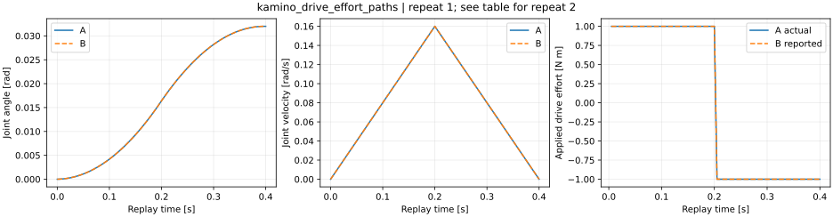
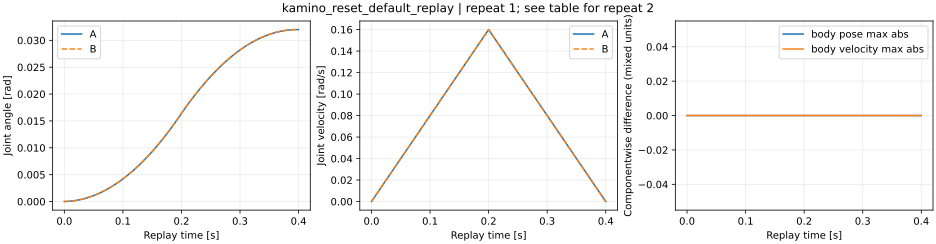
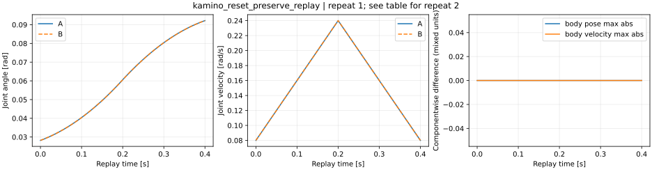

# Kamino 驱动与 reset 实测结果

3 个场景、6 个变体各用独立进程重复两次，正式共 12 个运行。冻结协议 SHA256 为 `9b4c235d475b1cb915714acebd078a4d0d5155736e8a300b0da52d02fa6dff74`，场景和门槛没有在运行后修改。NumPy 独立分析的 212 项文件、物理、重放与重复检查通过；原始指标见 [analysis.json](analysis.json)。

| 场景 | 主要观察 | 适用边界 |
|---|---|---|
| 显式力矩 vs 有界 implicit PD | 实际施加正反力矩均为 ±1 N·m；有效惯量 1.25 kg·m² 的角速度参考最大误差 2.73e-7 rad/s，Euler 角位移参考最大误差 1.04e-7 rad，锚点漂移最大 3.10e-6 m | 只覆盖饱和分支；不是非饱和跟踪或所有驱动模式验证 |
| 默认 reset vs fresh | 预热末 q≈0.02819994 rad、|lambda|=1 N·m；reset 恢复初始 pose 并将速度、乘子、加速度、内部时间清零；之后两组重放数组差值为零 | 使用 internal warmstart、默认 ResetConfig；不含 masks/flags/contact/FK reset |
| preserve reset vs fresh at same body state | body pose/velocity 保留，乘子与时间清零，关节数据重新由 body 状态派生；之后 fresh 与旧求解器重放数组差值为零 | 输入是动力学产生的一致 body 状态，不证明可修复任意不一致姿态 |

所有场景的两个独立进程重复中，所比较 pose/velocity 数组差值为零。这只描述当前 CPU、固定源码与单 revolute 场景，不是跨硬件确定性保证。

**有界 PD 的求解器终止收敛标志没有通过。** 在事前设置的 primal/dual/complementarity 容差均为 1e-7、最大 200 迭代时，有界 PD 场景的 terminal converged 比例为 0%，末 complementarity residual 约 4.4–4.7e-7 J；显式驱动对照为 100%。本协议将 status 作为诊断项，并以独立解析与重放指标验收，因此物理/生命周期检查通过而收敛标志仍为假。没有把此结果改写为“所有求解都已收敛”，也没有放宽阈值。

两种 reset 均没有清除外部 Control；记录验证 Control 在 reset 前后不变，实验在重放前显式设置目标和 effort。仅重新填充 State 与调用 solver.reset 不是等价的生命周期操作。

14 个早期 harness 记录保留：1 个在仿真前因 installed 路径假设失败；13 个完成记录因来源核验或延迟创建的 lambda 采样列不完整而排除。它们没有被计作物理失败，也没有被用于选择更好物理结果。修正记录见 [harness-revisions.json](harness-revisions.json)，复现说明见 [REPRODUCE.md](REPRODUCE.md)。正式每个 run 都对安装的 809 个受锁 Newton Python 文件核验，无缺失或变化。
