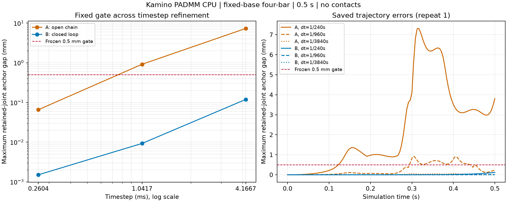

# Kamino 四杆闭环、FK 与步长细化实测

固定 Newton 1.7.0、commit `7e75abe28b8d69522bc0b34837aaed2c303dff5a`，CPU / Warp 1.18.0 / Python 3.12.14 / NumPy 2.5.4。每次正式运行核对了已安装 Newton 的 809 个受锁 Python 文件，全部 SHA256 与源码锁一致。只有本目录为新增产物，旧实验与源码未修改。

原 [协议](protocol.json) 与追加 [步长细化协议](protocol-refinement.json) 分别在对应运行前由主代理审核冻结。共 16 个正式运行（4 个 case × A/B × 2 独立进程重复），另保留 1 个仿真开始前的 harness 路径检查失败。harness 修复仅将绝对路径相同要求改为固定源码内容 hash 校验，见 [修订记录](harness-revisions.json)；所有正式运行使用同一 runner。

## FK：通过解析参考检查

四杆固定基座、单主动铰、其余铰被动。公共 `reset(FromActuatorQ)` 请求六个非奇异目标，比较 `fk.reset_state=True` 与 `False`。这是按顺序请求六个静态位姿，不是物理时间轨迹。

| 指标 | A：参考初态 | B：上一解初态 | 冻结门槛 |
|---|---:|---:|---:|
| 最大解析 body 位置误差 | 5.3141e-8 m | 1.8933e-7 m | 1e-5 m |
| 最大解析旋转误差 | 1.3328e-7 rad | 2.1491e-7 rad | 1e-4 rad |
| 最大被动关节坐标误差 | 1.2517e-7 rad | 2.6226e-7 rad | 1e-4 rad |
| 最大铰点 gap | 4.8660e-8 m | 1.6329e-7 m | 1e-5 m |
| reset success / 速度重置 | 全部成功 / 0 | 全部成功 / 0 | 全成功 / ≤1e-5 |

两种初值策略均通过全部预声明门槛；独立重复的 body/joint 数组一致。结论仅支持这个平面平行四边形的有限目标，不支持任意闭环、欠驱动 FK、奇异位形、全局分支选择或 continuation 性能优势。

## 动力学：保留两次未通过，细步长对照通过

A 移除闭环铰，B 保留闭环铰；其余几何、质量惯量、初态、重力与 0.02 N·m 主动力矩相同。每个运行模拟 0.5 s。A 也测量同一对虚拟闭环铰点的开口；两变体均关闭 FK、contact 和限位。闭环边的存在是结构干预，不能写成单参数调优实验。

| dt | A 保留树关节最大 gap | B 所有关节最大 gap | B 闭环 gap | 完整 pair 结论 |
|---|---:|---:|---:|---|
| 1/240 s | 7.31483 mm | 0.119206 mm | 0.118558 mm | 未通过：A 超 0.5 mm |
| 1/960 s | 0.917280 mm | 0.00929241 mm | 0.00928218 mm | 未通过：A 超 0.5 mm |
| 1/3840 s | 0.0657563 mm | 0.00150802 mm | 0.00150435 mm | 全部原门槛通过 |

dt=1/3840 s 时，A 的虚拟闭环开口最大 331.675 mm，B 主动角变化范围 0.788178 rad；保留关节 gap、铰轴一致性、非平凡运动、开口与比值判别均通过。原来的 0.5 mm 门槛始终未放宽。两级细化是在已保留的 dt=1/240 s 负结果后设计，再冻结、再运行；不能把它们描述为事先未知结果的盲目验证。



几何漂移在这三档 dt 下下降，但这不足以估计或证明积分器收敛阶数。PADMM `converged` 比例并不随之上升：B 依次为 87.5%、53.9583%、47.9688%；细步长最大 `r_d` 约 4.5001e-5。该状态只描述求解器的速度/冲量层停止条件，不能替代位置级几何验收；最后一组通过的也是明确列出的几何与证据门槛，不是“每步均收敛”或任意场景高精度的保证。并行执行时的计时仅留作原始观测，不用于性能比较。

## 可追溯产物

- [原分析](analysis.json)：FK passed；dt=1/240 s 为 `completed_with_failed_criteria`。
- [追加分析](refinement-analysis.json)：dt=1/960 s 仍未通过；dt=1/3840 s passed。
- [artifact 完整性与实际干预](artifact-verification.json)：17 个目录的协议/runner/raw hash、实际配置与拓扑通过检查。
- [趋势数据](timestep-trend.json)、[SVG](timestep-refinement.svg)：来自保存数组，未重新仿真。
- 每个 `runs/` 子目录保存协议、runner、scene、resolved config、环境、日志、result；正式运行均有 `trajectory.npz` 与 `solver-status.json`。

复核分析命令：

```powershell
.\experiments\.venv_multisolver\Scripts\python.exe -B -X utf8 experiments/kamino_mechanism_lab/loop_fk/analyze_experiments.py
.\experiments\.venv_multisolver\Scripts\python.exe -B -X utf8 experiments/kamino_mechanism_lab/loop_fk/analyze_refinement.py
.\.venv\Scripts\python.exe -B -X utf8 experiments/kamino_mechanism_lab/loop_fk/verify_artifacts.py
```

原始分析可独立重算，但正式证据已保留；重建知识库不应隐式执行仿真。本次尚无接触/驱动 PD/力限、多世界、GPU、任意拓扑或长期稳定实验。
