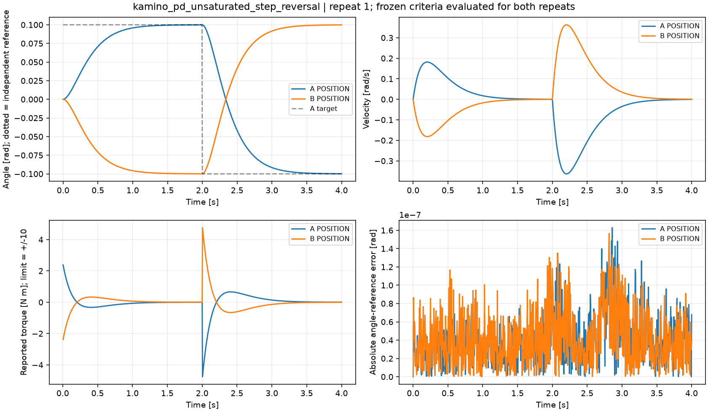
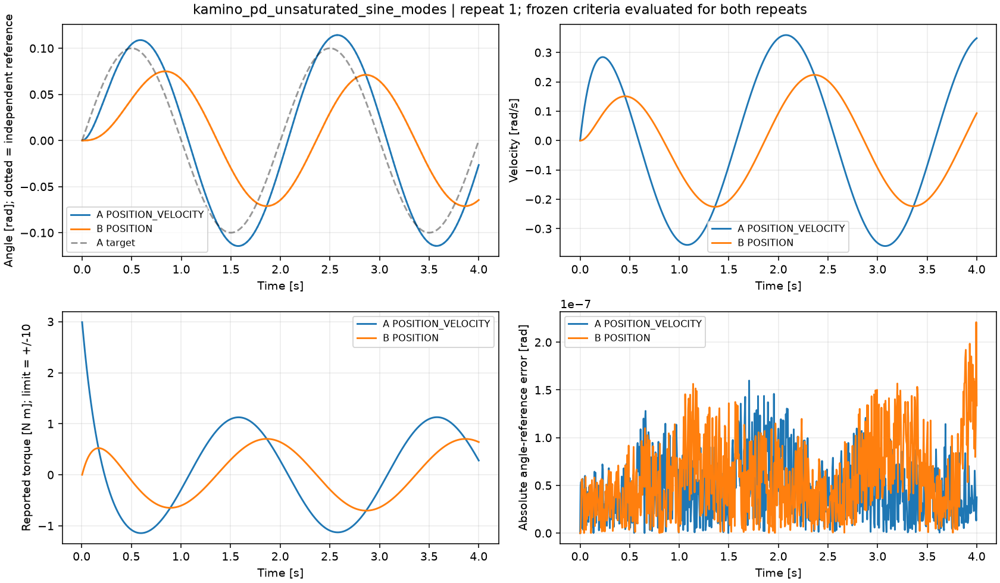

# Kamino 有界隐式 PD：非饱和跟踪结果

固定 Newton 1.7.0 commit `7e75abe28b8d69522bc0b34837aaed2c303dff5a`、CPU 单 world。两个 case、各两种设置、每设置两独立进程，共 **8 次正式运行**，**198 项冻结验收全部通过**。原始数组、完整配置与代码/协议 hash 均已保存；另保留 1 次 solver 创建前的 harness 失败，不列为物理结果。

## 实验回答了什么

场景为 COM 与世界 Y 铰轴重合的刚体转子，I=1 kg·m²，kp=25 N·m/rad、kd=10 N·m·s/rad、有限力矩上限10 N·m；无重力、接触、摩擦、armature。Euler h=0.005 s，每次4 s。协议在任何正式仿真前冻结，验收线未因结果修改。

源实现把隐式 PD 放入有界 effort constraint。未触界时，独立标量解为：

    v_next = [I*v + h*(kp*(qref-q)+kd*vref_used)] / [I+h*kd+h²*kp]
    q_next = q + h*v_next
    tau = I*(v_next-v)/h

POSITION 模式使用 vref_used=0，但保留 kd 阻尼；POSITION_VELOCITY 使用提供的目标速度。参考采用独立 float64 递推，不调用 Newton，不裁剪力矩。输出 `joint_lambdas_tau` 已是 N·m；求解器内部原始约束变量才是 N·m·s 冲量。

## 正负目标与中途反向

A先跟踪+0.1 rad、2 s时变为-0.1 rad；B为镜像。每个常目标区间末的最大位置误差为 **1.10506e-4 rad**，末速度最大 **5.00893e-4 rad/s**，分别低于0.002 rad与0.01 rad/s门槛。每段常目标能量没有正增量；目标切换产生的能量跳变按协议排除。

| 指标 | A | B | 冻结门槛 |
|---|---:|---:|---:|
| 最大角度参考误差 / rad | 1.62892e-7 | 1.56489e-7 | <=5e-4 |
| 最大速度参考误差 / rad/s | 3.56748e-7 | 2.79709e-7 | <=1e-3 |
| 最大力矩参考误差 / N·m | 3.57689e-6 | 3.66939e-6 | <=0.002 |
| 最小力矩裕量 / N·m | 5.239829 | 5.239826 | >=4 |

镜像A/B最大角度和为1.41561e-7 rad，最大速度和为1.19209e-7 rad/s，满足预设对称性门槛。两次独立进程的 body_q、body_qd、joint_q、joint_qd 数组完全相同。

## 动态目标和模式语义

两个模式都收到 qref=0.1*sin(pi*t) rad 和 target_qd=0.1*pi*cos(pi*t) rad/s。A为POSITION_VELOCITY，B为POSITION。命令在每步开始采样并保持；RMS将输出状态n+1与该步命令n对齐。末周期指状态样本401..800，启动的前两秒不进入这一指标，但全部瞬态仍接受离散参考检验。

| 指标 | A：POSITION_VELOCITY | B：POSITION | 冻结门槛 |
|---|---:|---:|---:|
| 末周期目标跟踪 RMS / rad | 0.01937779845 | 0.06645294668 | A<=0.03，B<=0.08 |
| 最大角度参考误差 / rad | 1.59785e-7 | 2.20985e-7 | <=5e-4 |
| 最大速度参考误差 / rad/s | 4.25431e-7 | 4.94491e-7 | <=1e-3 |
| 最大力矩参考误差 / N·m | 6.24696e-6 | 8.11437e-6 | <=0.002 |
| 最小力矩裕量 / N·m | 7.009787 | 9.296400 | >=4 |

A的末周期 RMS 比B低 **70.8398%**，超过预设30%改善门槛。两种模式均与各自离散参考吻合，支持 POSITION 忽略传入速度目标而POSITION_VELOCITY消费它的实现语义；没有把“POSITION没有使用速度前馈”误判成求解错误。两个设置的独立重复均为物理数组逐元素相同。

## 收敛与适用边界

8次运行共6400个实际仿真步均报告严格 `converged=True`；p/d/c容差均1e-7，预算200，观测最大迭代数14。最大r_p约4.09e-10、r_d约9.997e-8、r_c约1.124e-9。初始status为未求解占位，保存但不纳入这些统计；所有实际完成步的status均检查有限。

这个结果与上一组高增益、低力限、持续饱和工况的低收敛比例并不矛盾。**此处证明的是特定非饱和场景通过严格停止条件，没有修复或解释其他工况的收敛缺口。** 不能把结果推广为任意增益、步长、频率、力限、接触或多关节均收敛。

所有运行都保持至少4 N·m的事前裕量要求，实际全组最小为5.239826 N·m；因此参考未裁剪假设有效。仍未覆盖不同带宽/增益/惯量组合、临界与过临界采样、关节耦合、接触扰动和GPU。有限力限变更及饱和边界另由专门实验组处理。

## 可审计文件

- [protocol.json](protocol.json)：冻结SHA256 `42406443ed54c3562b9f4af4bca1ec9cf3e1dc22f6027ca097507296032286db`。
- [analysis.json](analysis.json)：每次run指标、198项检查、迭代分布、收敛诊断与重复对照。
- [publication.json](publication.json)：供知识库统一catalog整合的两case记录，保留r1与reproduction r2。
- [REPRODUCE.md](REPRODUCE.md)：运行与分析命令、采样约定及单位说明。
- [harness-revisions.json](harness-revisions.json)：首版将协议预条件标签误映射到stabilization config而失败；root批准映射到实际 `Config.dynamics.preconditioning=True`，协议未修改。
- [static-config-validation.json](static-config-validation.json)：15项配置字段的源码AST归属核验。

正式runner SHA256 `595b6dc3c51be31430e67519e1663736f7d645cb6abe0472f439e0263ef46e24`。每次run各自核验全部809个安装Python源文件与source-lock一致。私有wrench/配置读取仅用于观测，场景、求解器与控制通过公开API设置。
