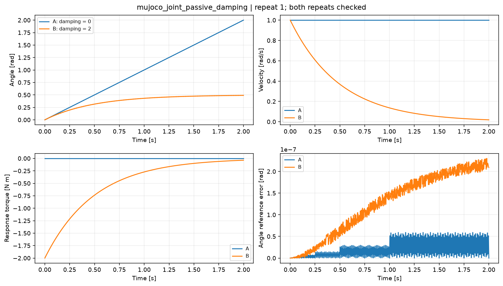
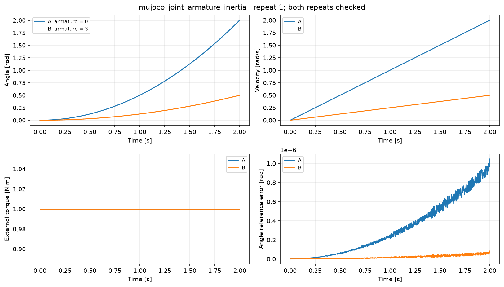
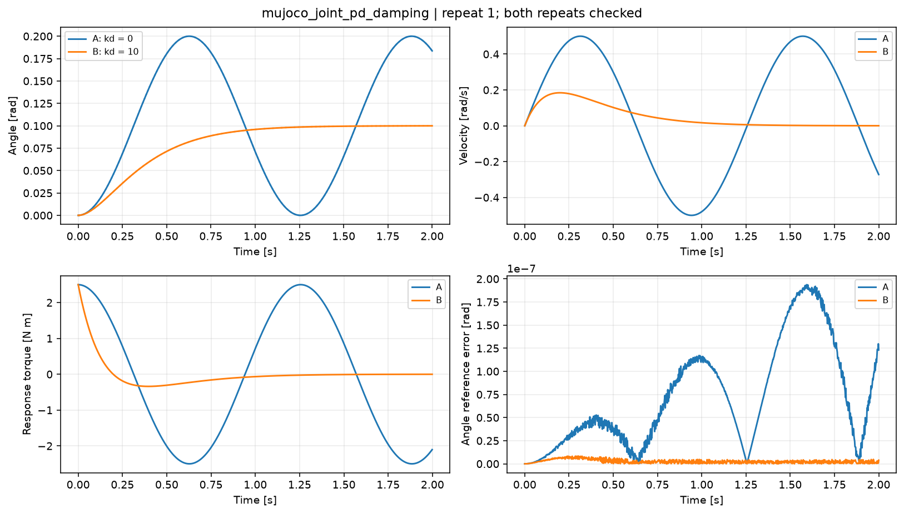
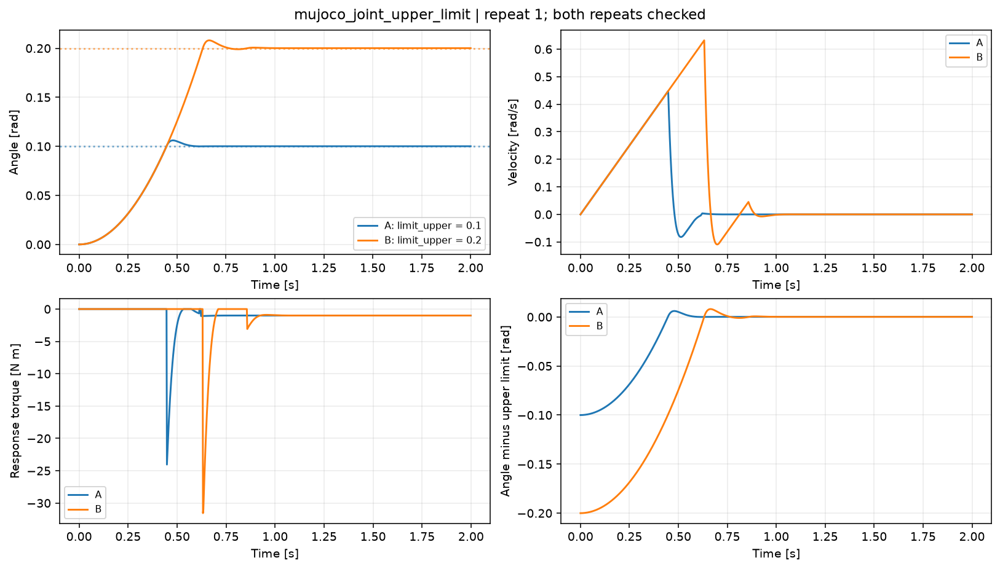

# MuJoCo 关节参数实验结果

4个单因素案例、每个A/B各两独立进程，**16次正式运行、338项验收全部通过**。各设置两次运行的body_q、body_qd、joint_q、joint_qd数组完全相同。另保留一次原生质量矩阵观测接口错误，发生在任何step之前；修正未改变冻结协议或动力学。

| 参数与场景 | A | B | 可得结论 |
|---|---|---|---|
| 被动damping，初速1rad/s、无驱动 | 0：末速1，能量不变 | 2：末速0.0184623，能量剩0.03409% | 被动阻尼耗散运动，区别于actuator的target_kd |
| armature，同1N·m外力矩 | 0：I_eff约1，末速2rad/s | 3：I_eff约4，末速0.5rad/s | 额外广义惯量把加速度与速度降至约1/4，非物理body质量增加 |
| POSITION驱动，kp固定25、目标0.1rad | kd0：过冲0.100001rad | kd10：零过冲，末误差5.50e-5rad | 驱动阻尼抑制振荡；这是kd扫描，kp只在25验证导出生效 |
| 关节上界，同1N·m外力矩 | 0.1rad：反力始于0.448s | 0.2rad：反力始于0.632s | 停止位置随上界平移0.1rad，约束是软限位 |

模型为COM与Y铰轴重合的刚体，名义惯量1kg·m²、无接触或重力。native质量矩阵实测0.999999523与3.999999523kg·m²，落在冻结1e-6惯量误差范围内，不能把浮点导出误差隐藏成“严格等于1/4”。

前3case全部轨迹吻合独立float64标量离散参考，最大转角误差1.05e-6rad、速度误差1.16e-6rad/s、力矩误差4.73e-6N·m，分别小于冻结1e-4、1e-4和.001门槛。Euler被动阻尼隐式、actuator阻尼显式，不能套用Kamino全隐式PD公式；这一区别由[MuJoCo3.15数值积分定义](https://mujoco.readthedocs.io/en/3.15.0/computation/index.html#numerical-integration)和锁定Newton导出源码共同支撑。

## 限位的有效证据与边界

限位A/B首次反力时刻与独立自由飞行递推的首个越界输入状态完全一致。最大穿越分别0.006066/0.008049rad，均小于预设0.02rad；末半秒平均穿越约1.10e-4rad，末反力约-1N·m抵消外力矩，最大力平衡误差2.13e-7N·m。末位置平移与.1rad范围差的误差为6.56e-8rad。

导出的jnt_range、margin0、solimp约[.9,.95,.001,.5,2]和solref约[.03999997,.79056966]均检查通过，后者对应固定Newton limit_ke20000/limit_kd1000经过invweight和阻抗缩放。实验没有硬裁剪q，也没有宣称精确复现软限位瞬态或把存在穿越等同于求解失败。

## 适用范围

这里只验证Newton1.7.0/native MuJoCo3.15.0、CPU、单关节、固定h=.002s和Euler。选择Euler为方便审计离散公式，不是建议替代默认implicitfast。未覆盖MuJoCo Warp、耦合多关节、不同惯量/频率/增益范围、kp扫描、努力或速度限幅扫描、运行时参数变更以及接触中的关节控制。没有把这些缺口计作已完成。

力和状态严格区分：`qfrc_*[n]`属于积分前状态n，输出state[n+1]属于该步结束。全部原始数据有限，native警告计数为0。无约束案例原生迭代数为0表示无需约束迭代，不是未收敛；限位观测最大迭代数1，不据此作通用性能结论。

可审计文件：[冻结协议](protocol.json)、[独立分析](analysis.json)、[catalog交付](publication.json)、[复现说明](REPRODUCE.md)、[harness修订](harness-revisions.json)。协议SHA256为`36ffb87df53457e8cefd36324a8d95fdf4bd49d915d495a28639b6372f90b77c`。
