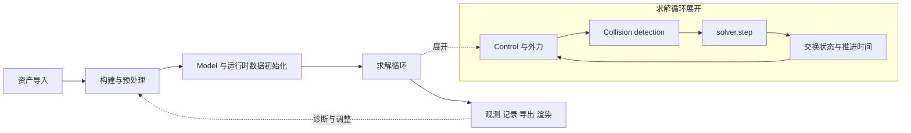

# Newton 知识库重构 PRD

版本：0.2  
状态：依据独立审核修订的开发规划草案  
日期：2026 年 10 月 28 日  
事实基线：Newton 1.7.0，commit `7e75abe28b8d69522bc0b34837aaed2c303dff5a`。

本项目将现有知识库组织为一个解释 Newton 整体工作方式、支持逐阶段查阅，并可深入不同 solver 的本地知识网站。网站与只读 MCP 共用知识记录。首版同时交付主要模块入口、公共流程知识、三个深入 solver 专区，以及 agent 可用的最小检索与取证契约；算法深化和新增物理实验随后扩展。

修订依据：[GPT-6 Astra 独立审核](review/PRD_Astra_Review.md)。[原始 v0.1](history/PRD_v0.1.md) 保留供对照。本版中的首版能力与验收门槛是开发要求，不表示当前网站和 MCP 已实现；当前能力基线以审核报告及其实际调用记录为准。

## 1 背景与目标

当前网站以 VBD 样板发展而来，公共导航与 VBD 专属内容尚未分开。MuJoCo 和 Kamino 虽已有独立入口，但进入全局参数目录、参数实验室或现象诊断，仍容易回到 VBD。用户难以判断一条知识属于 Newton 公共流程、某个 solver，还是某组已验证实验。

| 当前问题 | 目标行为 |
|---|---|
| 知识文档把 VBD 分成理解、配置、复现三组，而另外两个 solver 各自成组 | Newton 公共知识独立组织；每个 solver 使用相同的内部目录 |
| 全局参数目录默认显示 VBD | 参数目录属于 solver 专区；全库检索中的参数必须显示归属 |
| 参数实验室实际只有 VBD 数据 | 每个 solver 都有实验室入口，分别展示已有实验或待验证计划 |
| 现象诊断主要针对 VBD | 公共诊断先判断流程阶段，再跳到对应 solver 的诊断与实验 |
| 用户先看到参数，难以理解整体求解流程 | 首页先解释对象与数据流，再从流程节点进入知识条目 |

产品面向两类使用者：人通过流程图理解、排错和查证据；agent 通过同一套记录定位阶段、solver、参数和出处。首版对全部主要模块建立入口与明确的覆盖状态，对 VBD、MuJoCo、Kamino 做深入整理。模块入口覆盖、任务深度和物理实验覆盖分别验收。

## 2 信息架构

采用两条主阅读路径：**按 Newton 仿真流程学习**，以及**按 solver 深入学习与实验**；公共模块与跨阶段主题索引连接两条路径。开发规范和测试方法属于公共知识，放在独立入口。

```text
Newton Knowledge
├─ Newton 总览
│  ├─ 核心对象与职责
│  ├─ 经典仿真流程图
│  └─ 开发规范与测试入口
├─ 仿真流程
│  ├─ 资产导入
│  ├─ 构建与预处理
│  ├─ Model 和运行时数据初始化
│  ├─ 求解循环
│  │  ├─ Control 与外力
│  │  ├─ Collision detection 与 Contacts
│  │  └─ Solver step 与状态推进
│  └─ 观测与结果输出
├─ 模块与跨阶段主题
│  ├─ 全部公开 API 与概念入口
│  ├─ 运动学与机器人控制
│  ├─ Worlds 与批量选择
│  ├─ 耦合求解
│  ├─ 可微仿真
│  └─ 生命周期 复位与量测
├─ Solver 中心
│  ├─ 类型与能力概览
│  ├─ VBD 专区
│  ├─ MuJoCo 专区
│  ├─ Kamino 专区
│  └─ Featherstone ImplicitMPM SemiImplicit Style3D XPBD 索引
├─ 开发与测试
│  ├─ Coding style 和公共 API 约定
│  ├─ Newton 测试与 examples
│  └─ 复现与验证方法
├─ 全库检索与证据
└─ Agent 与 MCP 接入
```

全局侧栏不再放置默认指向 VBD 的裸名称“参数目录”“现象诊断”“参数实验室”。这些入口进入 solver 专区后出现。全库检索可以聚合相同类型的内容，但必须显式展示筛选范围。

Solver 中心可以按粒子与可变形体、关节坐标刚体系统、最大坐标约束系统等方式解释不同方法；分类允许交叉。首版必须为八个具体 backend 提供可检索入口，三个已收录 solver 提供深入内容，其余五个明确标为索引级。Coupled 是单独的跨 solver 框架，不与八个 backend 混算。

### 首版主要模块覆盖清单

范围以固定快照的 [公开 API 导航](../sources/newton-v1.7.0/docs/api/_toctree.rst)、[官方 Concepts 导航](../sources/newton-v1.7.0/docs/index.rst) 和 [solver 导出](../sources/newton-v1.7.0/newton/_src/solvers/__init__.py) 为分母。下面的目标 ID 是 P0 待冻结的知识记录标识，不是当前已存在的记录；标题、页面或文件位置变化不应改变已冻结 ID。

入口级 I：具备可检索摘要、职责与边界、固定版本出处、公共 API、例子或测试位置、覆盖与缺口状态。解释级 E：在 I 上增加机制或用法说明。任务级 T：在 E 上增加带初始化和更新顺序的配方，并通过冻结的 MCP 查询任务。实验级 X：有对应运行数据，按具体案例标注。四种深度分别记录，不把一组实验提升为整个模块已实测；明确延后的子主题记录原因和后续阶段。

**公开 API 入口分母为 12，分别验收。** 每行的模块文件和 `docs/api/` 对应页为固定版本索引依据。

| API 入口 | 首版内容与目标 ID | 页面归属及流程关联 | 首版深度与后续边界 |
|---|---|---|---|
| `newton` | `module:newton`：Builder、Model、State、Control、Contacts、标志、FK 与动力学辅助入口 | 核心对象；初始化和求解循环 | E；对象生命周期配方为 T，逐字段解释继续扩展 |
| `newton.actuators` | `module:actuators`：Drive、Clamping、Delay、解析与执行链 | 控制主题；control | E；基础目标执行为 T，神经驱动内部实现后续深化 |
| `newton.controllers` | `module:controllers`：DifferentialIK、JointImpedance、OperationalSpace 与 model-free 差异 | 机器人控制；control | E；所选 IK 控制链为 T，不要求所有控制器首版等深 |
| `newton.geometry` | `module:geometry`：几何表示、SDF、惯量、broad phase、narrow phase | 预处理和 collision | E；full surface 关联任务为 T，原始碰撞函数先做索引 |
| `newton.ik` | `module:ik`：目标、优化器、IKSolver、与 FK 和 controller 的关系 | 运动学主题；初始化和 control | E；入口和控制衔接为 T，优化器推导后续深化 |
| `newton.math` | `module:math`：变换、四元数、twist、wrench 与空间量约定 | 数值约定；跨阶段引用 | I，流程必要的坐标解释为 E；不要求逐函数教程 |
| `newton.selection` | `module:selection`：ArticulationView、目标选择、索引与布局 | Worlds 与批量；初始化、control、reset | E；批量控制和复位配方为 T |
| `newton.sensors` | `module:sensors`：Contact、IMU、Camera、FrameTransform、TiledCamera | 量测主题；初始化和输出 | E；接触力量测为 T，渲染器专属配置后续深化 |
| `newton.solvers` | `module:solvers`：接口、八 backend 能力入口、coupled 桥接 | Solver 中心；solver step | E；三 solver 深入，其余按下表为 I |
| `newton.usd` | `module:usd`：导入语义、SchemaResolver、属性和坐标读取 | 资产主题；导入和预处理 | E；schema 工具逐项先做索引 |
| `newton.utils` | `module:utils`：mesh、着色、cable、资产、EventTracer 与 benchmark 工具地图 | 工具主题；预处理、输出、开发测试 | I，流程必需工具为 E；辅助算法逐步增加 |
| `newton.viewer` | `module:viewer`：GL、RTX、USD、File、Rerun、Viser、Null 的用途与依赖 | 输出主题；观测、导出和回放 | E；明确官方记录回放与本知识库实验回放的区别 |

**官方 Concepts 分母为 14，分别验收。** 来源均为固定快照 `docs/concepts/` 中下列文件，目标页面可以复用上表模块知识，但必须有独立可发现的主题记录。

| 官方主题及来源文件 | 目标 ID | 首版目标页面与内容 | 深度 |
|---|---|---|---|
| Worlds `worlds.rst` | `concept:worlds` | Worlds 与批量：replicate、world 索引、共享对象与后端差异 | E，批量配方 T |
| Articulations `articulations.rst` | `concept:articulations` | 关节、拓扑、闭环、mimic、equality、tendon 的能力入口 | E |
| Deformable Objects `deformable_objects.rst` | `concept:deformables` | cloth、soft、particles、Rod、TetMesh 与 MPM 建模边界 | E；VBD 深入，其他路线先做入口 |
| Mass and Inertia `mass_inertia.rst` | `concept:mass-inertia` | 质量、惯量、质心及单位；关联导入与预处理 | E |
| Sites `sites.rst` | `concept:sites` | 非碰撞参考点、传感器附着、与几何的区别 | E |
| Sensors `sensors.rst` | `concept:sensors` | 传感器输入、配置、分配与更新 | E，接触量测 T |
| Conventions `conventions.rst` | `concept:conventions` | 坐标、旋转、力、速度、单位与布局速查 | E |
| USD Parsing `usd_parsing.rst` | `concept:usd-parsing` | 资产解析、schema 与 Newton 模型的对应 | E |
| Custom Attributes `custom_attributes.rst` | `concept:custom-attributes` | 注册、构建解析、solver 自定义数据与生命周期 | E |
| Solver Observables `solver_observables.rst` | `concept:solver-observables` | 请求、容量、Contacts 绑定、step 和输出读取顺序 | E，接触量测 T |
| Collisions and Contacts `collisions.rst` | `concept:collisions` | 几何接触、管线、数据、过滤和后端路径 | E，碰撞配方与取证 T |
| Simulation Tuning `simulation_tuning.rst` | `concept:simulation-tuning` | 现象排查、dt、预算、材料与量测的分工 | E；与各 solver 诊断及案例关联 |
| Coupled Solvers `coupling.rst` | `concept:coupling` | ModelView、ownership、Proxy 与 ADMM、反馈、子步与支持边界 | E，耦合方案定位 T |
| Actuators `actuators.rst` | `concept:actuators` | 驱动组合及其和 Control、controller 的分工 | E，所选控制链 T |

**具体 solver backend 分母为 8。** 排除 SolverBase 抽象基类，不重复计入 `style3d` 模块。出处为公开导出、`docs/solvers/index.rst` 和各实现；支持程度以实际版本证据填写。

| Backend | 目标 ID | 首版交付深度 | 首版实验承诺 |
|---|---|---|---|
| VBD | `solver:vbd` | 深入专区，现有参数、机制、诊断与案例按规范迁移 | 保留既有 17 组 A/B，覆盖以案例为单位 |
| MuJoCo | `solver:mujoco` | 深入专区，包含转换、后端、条件默认与限制 | 新 A/B 在 P4 交付 |
| Kamino | `solver:kamino` | 深入专区，包含分层配置、PADMM/DVI 与实验性状态 | 新 A/B 在 P4 交付 |
| Featherstone | `solver:featherstone` | I：职责、模型和关节能力、公开 API、来源与例子 | 首版不要求新实验 |
| ImplicitMPM | `solver:implicit-mpm` | I：材料与建模路线、依赖与能力出处 | 首版不要求新实验 |
| SemiImplicit | `solver:semi-implicit` | I：积分与适用对象、限制、来源与例子 | 首版不要求新实验 |
| Style3D | `solver:style3d` | I：功能、依赖与可用条件、来源与例子 | 首版不要求新实验 |
| XPBD | `solver:xpbd` | I：约束求解路线、参数入口、能力与例子 | 首版不要求新实验 |

入口级 backend 的参数知识尚未整理时，精确符号仍可定位到公开签名和源码入口；结构化参数读取须返回明确的覆盖缺口。缺少深入知识不等于 backend 不支持该功能。

**跨阶段与开发主题单列验收，不另造一个总覆盖百分比。**

| 主题 | 目标 ID 与固定来源 | 首版深度与第一归属 |
|---|---|---|
| 运动学与机器人控制 | `topic:robot-control`；顶层 eval 系列、`newton/ik.py`、`newton/controllers.py` | T；连接 IK、controller、selection、Control、actuator 与 solver |
| Worlds 与批量复位 | `topic:worlds-batching`；`worlds.rst`、`newton/selection.py`、solver reset 接口 | T；说明选择、掩码、目标布局和后端差异 |
| 耦合求解 | `topic:coupling`；`coupling.rst`、`newton.solvers.experimental.coupled` | T；单列框架，配方允许多个 solver，不计入八 backend 分母 |
| 可微仿真 | `topic:differentiable-simulation`；solver 能力表与 `newton/examples/diffsim` | E；requires_grad、Warp Tape、状态历史与能力限制；深层梯度实验后续扩展 |
| 生命周期与量测 | `topic:lifecycle-observation`；SolverBase、custom attributes、sensors 与 observables 文档 | T；初始化、每子步、每帧、reset、notify_model_changed 与缓存处理 |
| 环境与兼容 | `topic:environment`；`docs/guide/installation.rst`、`compatibility.rst` | E；CPU/GPU、后端及可选依赖的实际条件 |
| 开发与上游测试 | `topic:development-testing`；CODING_GUIDELINES、development、tests、examples | E；区分四类验证与真实执行范围 |
| 迁移与外部集成 | `topic:migration-integrations`；`docs/migration.rst`、`docs/lab/isaac-lab.rst`、`docs/integrations/` | I；版本迁移与外部系统边界，深入集成后置 |

以上每一项在 P0 覆盖台账中记录“当前深度、首版目标、目标记录与页面、固定出处、验收任务、延后内容、负责阶段”。本节列的是首版要求；不能将目标表直接展示为已经完成的覆盖统计。

### 每个 solver 的统一目录

| 页面 | 内容 |
|---|---|
| 总览与适用范围 | 适合的问题、对象类型、后端、限制和实验性状态 |
| 原理与算法 | 数学问题、算法流程、关键数值机制 |
| 论文与源码 | 原始文献、代码导读、机制对应和实现差异 |
| 参数与模型输入 | 构造参数、嵌套配置、模型与材料输入、流程设置的分层说明 |
| 参数实验室 | example—参数效果表、A/B 结果、三维回放、曲线和复现资料 |
| 现象诊断 | 现象、候选原因、排查顺序、相关阶段与实验 |
| 版本与复现 | 固定版本、依赖、数据出处和适用条件 |

目录一致，内容覆盖程度可以不同。VBD 是结构完整的首个样板，已有 17 组 A/B、34 次运行；这不表示所有参数均已独立实测。MuJoCo、Kamino 保留已有静态知识和待验证诊断，实验室先展示计划与状态。

## 3 Newton 总入口

首页回答三个问题：Newton 的核心对象如何分工，一次仿真如何完成，以及用户应从哪个阶段或 solver 继续深入。

### 核心对象

| 对象 | 首页需要解释的职责 | 展开后的重点 |
|---|---|---|
| ModelBuilder | 构建或导入场景的入口 | bodies、joints、shapes、材料、预处理与 finalize |
| Model | 模型结构、物理属性与配置 | 与 State 的边界、设备、worlds、自定义属性及受支持的更新方式 |
| State | 某一时刻的位置、速度等动态数据 | 输入输出状态、状态交换、初始状态与外力生命周期 |
| Control | 每步使用的驱动目标或控制输入 | 与控制器、轨迹、执行器模型的区别 |
| Contacts | 接触生成阶段提供给求解器的数据 | 几何接触与物理接触响应的区别 |
| Solver | 根据模型、状态、控制和接触推进仿真 | step 接口、算法、时间步、配置及后端差异 |

首页同时提供 Coding style 与 Newton test 的简短介绍，详细内容进入“开发与测试”。首页不承担完整 API 手册的篇幅。

## 4 经典仿真流程

主流程按用户任务组织，预处理通过 ModelBuilder 等实际构建接口完成。可选步骤、后端特有步骤和运行期步骤需清楚标示。



输出可以每帧进行，流程图中的末端位置表示其职责，不表示必须等整个仿真完成后才渲染。碰撞检测是逻辑阶段：外部 CollisionPipeline 与后端内置管线需要分别说明。部分路径在 `solver.step()` 内部完成接触生成，不能要求所有 solver 都额外执行一次外部 collide。

### 阶段知识范围

| 阶段 | 首期知识 | 输入与输出 | 典型排查问题 |
|---|---|---|---|
| 资产导入 | URDF、MJCF、USD、程序化构建，坐标与单位，模型层级 | 资产及导入配置 → builder 中的场景描述 | 尺度错误、关节参考不一致、可视几何与碰撞几何不一致 |
| 构建与预处理 | mesh approximation 或 convex decomposition、碰撞过滤、质量与惯量、按 solver 需要的着色等 | builder 与几何 → 适合目标路径的模型描述 | 非凸几何变成凸包、误过滤、质量惯量异常、缺少必要预处理 |
| 初始化 | finalize、设备、worlds、State、Control、Contacts、solver 构造及初始姿态 | 模型描述 → Model 和运行时对象 | 初始姿态不一致、状态未正确初始化、配置与后端不匹配 |
| 求解循环 | 控制与外力、接触生成、step、状态交换、子步和时间推进 | 当前 State 与输入 → 下一 State | 无响应、穿透、振动、滑移、错误同步、时间步混淆 |
| 观测与输出 | sensors、solver observables、状态记录、曲线、Viewer、导出与回放 | 状态及诊断量 → 量测与可查看产物 | 只看渲染误判物理、采样时间不一致、输出无法复现 |

每个阶段都有独立链接，可以从首页展开，也可以直接进入完整知识页。mesh decomposition、着色、SDF 等选项需要注明适用的几何和 solver，不列为所有仿真的固定必做步骤。

### 展开交互

点击阶段后，先显示“作用、输入输出、常见问题、官方文档”摘要；再进入完整知识页，阅读 API、源码、例子、适用条件和诊断。展开第二层时保留所在流程，允许用户返回上一层。折叠不应丢失选中的 solver 或条目。

完整页面通过面包屑明确位置，例如“Newton → 仿真流程 → 碰撞检测 → full surface contact”，以及“Solver 中心 → VBD → 参数实验室 → full surface”。同一知识记录可以被两条路径引用。

## 5 求解循环的三个知识库

| 知识库 | 核心内容 | 连接到 solver 专区的方式 |
|---|---|---|
| Control 与外力 | 控制器与 Control 对象、关节目标、力与力矩、执行器参数、外力清理与重新施加、控制频率与仿真子步 | 说明不同 solver 的驱动支持、隐式或显式处理、目标与增益配置 |
| Collision detection | 几何表示、broad phase、narrow phase、过滤、margin 与 gap、容量、碰撞频率、外部与内置管线 | 展示目标 solver 接受什么接触数据，以及它自己的接触路径和限制 |
| Solver step | step 输入输出、dt、子步与迭代区别、状态交换、诊断量、缓存、复位与更新 | 跳到各 solver 的算法、参数、论文、实验与版本边界 |

公共知识说明职责与接口，solver 专区说明具体实现与差异。一个 solver 的默认值、残差定义或实验结论不能自动提升为公共结论。

以 full surface contact 为样板：参数的定义归碰撞管线，VBD 实验室保存已执行的 A/B 案例；VBD 参数页和公共碰撞页都引用该定义与案例。物理现象、参数归属和实验适用范围分别保留。

公共现象诊断也按流程分流。例如“物体穿透”先检查导入几何、碰撞表示、过滤与接触记录，再进入目标 solver 的响应与收敛诊断；“控制未生效”先检查驱动输入和同步，再检查具体 solver 的驱动支持。

### 首版生命周期配方

P2 必须交付下面三类可检索配方，每类选定并标明其真正支持的 solver、后端与设备，不要求每个 solver 实现三条路径。配方是有来源的调用顺序说明，物理运行证据另行标注。

| 配方目标 ID | 必须说明的顺序与条件 |
|---|---|
| `recipe:external-collision` | Model 与初态 → 外部 CollisionPipeline 与 Contacts → 按要求分配 observables 和 sensors → 每子步控制、碰撞、step、交换 State → 按采样周期读取；明确碰撞频率 |
| `recipe:solver-owned-collision` | 选择支持内置管线的 solver/config → 初始化其接触与观测资源 → step 内外各承担什么 → 读取输出；明确调用方是否传入 Contacts |
| `recipe:mujoco-native-contact` | MuJoCo 内部碰撞选择与后端条件 → 接触或观测数据的准备 → step → 按已支持接口量测或导出；不把 Newton 接触导入路径和原生接触路径混在一起 |

每条配方均包含 setup、每仿真子步、每控制帧、每输出帧、reset 或模型更新五个时段。接触容量何时确定、观测数据绑定哪个 Contacts、请求哪些 observables、使用哪个输出 State、sensor.update 的时点，必须能从配方追到固定版本出处。

控制主题同时解释 `joint_target_q` 的坐标布局与 `joint_target_qd` 的 DOF 布局，关联 `use_coord_layout_targets`、ArticulationView 和相应 solver。模型更新与复位需说明 `notify_model_changed`、受支持标志、缓存和捕获图的处理条件。耦合主题另提供 `recipe:coupled-rigid-deformable`，明确 ModelView、ownership、子步、状态或力交换和 attachment 支持条件。

## 6 开发规范与 Newton 测试

开发与测试部分解释如何编写可维护、符合 Newton 约定并可验证的仿真代码，内容均关联到固定版本官方来源。

- Coding style：公共导入路径、类型与签名、命名、单位、docstring、Warp 数组约定，以及公共 API 与内部实现的边界。
- Newton test：测试组织、运行入口、按名称选择测试、依赖与设备条件、测试失败的判断，以及 examples 的 `test_post_step()` 和 `test_final()`。
- 复现方法：固定版本、依赖、资产、配置、控制轨迹、随机性、设备与记录指标。

页面区分 Newton 上游测试、本知识库的结构或链接检查、网站或 MCP 检查、物理参数实验。展示测试命令不代表已执行；状态记录必须附带实际环境与范围。本项目不把 RoboSimStudio 的测试命令当作 Newton 官方测试入口。

## 7 Solver 专区与实验室

### 参数和诊断的范围

进入 solver 专区后，参数、文档、诊断、实验和论文导航都保留当前 solver。跨 solver 访问必须有可见的切换动作或明确链接；共享知识显示为公共内容。

参数页至少区分 solver 构造参数、配置字段、模型与材料输入、控制输入、碰撞或时间步设置。参数详情保留声明默认值、条件解析、单位或类型、源码出处及实验关联。Kamino 的后端组合默认值与 MuJoCo 的属性解析继续按现有证据保留。

诊断条目列出现象、可能涉及的流程阶段、排查步骤、候选参数组、量测指标和适用条件。待验证计划与已测经验使用不同状态，不能因文档迁移改变证据等级。

### 通用参数实验表

每个 solver 的实验室使用同一表结构：一行对应一个 example 和一个参数或参数组，展示两组设置的效果对照。参数组说明为什么共同干预，以及比较中发生了哪些实际配置变化。

| 一行实验的必需信息 | 展示与记录要求 |
|---|---|
| 实验身份 | solver、版本、场景、问题、参数归属和固定条件 |
| A 与 B | 两侧参数值、完整配置、变化列表和共同仿真时长 |
| 可视效果 | 三维回放、统一镜头与时间基准，按需查看二维曲线 |
| 量测 | 主指标、单位、曲线及必要的求解或性能统计 |
| 解释 | 观测结果、源码或论文机制、与官方指南的对应及适用范围 |
| 复现 | 程序、资产、依赖、设备、run ID、原始数据与哈希 |
| 状态 | 待设计、待运行、已运行、运行失败或环境受限 |

已运行只说明保存了执行证据，不能自动代表达成预期物理响应。参数改变后效果不明显也可以保留为结果；运行失败和环境受限分别记录原因。性能比较需说明计时范围和预热方式。

首批扩展实验建议如下，具体场景与取值在实验设计阶段确定：

| Solver | 优先参数组或问题 | 主要量测 | 设计边界 |
|---|---|---|---|
| MuJoCo | 迭代预算与终止容差 | 约束误差、残差或终止信息、步进耗时 | 冻结接触模型、积分器和 dt |
| MuJoCo | 接触软化参数 | 稳态压入、回弹或振动、滑移 | 记录实际材料转换与 CPU 或 Warp 路径 |
| Kamino | PADMM 预算与残差容差 | 闭环误差、r_p、r_d、r_c、converged | 同时记录残差定义和单位 |
| Kamino | 接触或关节稳定化 | 漂移、穿透、振动与数值收敛 | 明确 alpha、beta、gamma、delta 分别作用于什么 |

PADMM 与 DVI 的比较可作为后续“后端配置组”实验。切换时需记录依赖默认值的变化，不能标为只改变一个独立参数。建议先完成 MuJoCo 最小实验，再扩展 Kamino；每组均先核实可运行的依赖与设备组合。

## 8 官方文档与证据

每个阶段都提供两类出处：可阅读的 Newton 官方在线文档，以及固定 commit 的文档或源码位置。在线 `latest` 作为阅读入口，1.7.0 的事实以本地固定快照及对应 commit 为基线；页面显式区分两者。

| 知识主题 | 官方在线阅读入口 | 固定版本索引对象 |
|---|---|---|
| 框架和核心对象 | [Overview](https://newton-physics.github.io/newton/latest/guide/overview.html) | `docs/guide/overview.rst`、公开 API 与 sim 对象定义 |
| 资产与模型构建 | [Tutorials](https://newton-physics.github.io/newton/latest/guide/tutorials.html)、[USD Parsing](https://newton-physics.github.io/newton/latest/concepts/usd_parsing.html) | `docs/tutorials/00_introduction.ipynb`、ModelBuilder 导入接口 |
| 几何和碰撞预处理 | [Collisions](https://newton-physics.github.io/newton/latest/concepts/collisions.html) | `docs/concepts/collisions.rst`、ModelBuilder 的 approximate_meshes 与过滤接口 |
| 控制与驱动 | [Actuators](https://newton-physics.github.io/newton/latest/concepts/actuators.html) | `docs/concepts/actuators.rst`、controllers 与 Control 接口 |
| 求解器 | [Solver overview](https://newton-physics.github.io/newton/latest/solvers/index.html) | `docs/solvers/index.rst` 及三个 solver 的文档与实现 |
| 结果与可视化 | [Viewers and Debugging](https://newton-physics.github.io/newton/latest/guide/visualization.html) | `docs/guide/visualization.rst`、记录与回放 examples |
| 代码规范 | [Source Code Guidelines](https://newton-physics.github.io/newton/latest/guide/source_code_guidelines.html) | `CODING_GUIDELINES.rst` |
| 测试与开发 | [Development](https://newton-physics.github.io/newton/latest/guide/development.html) | `docs/guide/development.rst`、`newton/tests`、`AGENTS.md` |

这些固定版本索引均可在 [官方 commit](https://github.com/newton-physics/newton/tree/7e75abe28b8d69522bc0b34837aaed2c303dff5a) 中定位。后续实现需要将索引细化为具体文件、章节、API 或行号，而非仅链接到文档首页。

关键要求：阶段摘要提供适用版本、逻辑职责和至少一个官方来源；数值默认值追到实现或注册位置；实验结论追到对应运行。一个主题可以没有单独的官方概念页，此时组合 API、教程和源码引用，不构造不存在的文档入口。

被引用文件必须进入固定快照的校验范围，或显式标为仅来自本地快照、未核对原始文件哈希。返回当前 SHA-256 不等于核对了基线哈希。catalog、关系图、索引和记录使用共同的构建标识；部分更新造成构建不一致时，不返回看似完整的混合证据。

## 9 数据与 MCP 的共同结构

网站层级由内容属性驱动，八个 backend 使用共同注册表，三个深入专区使用一致模板。公共条目通过显式关联被多个页面引用。首版延续本地知识文件、SQLite 检索、只读 stdio 和现有六个工具，优先完善内容与调用契约。

### 记录的最小字段

| 字段组 | 首版要求 |
|---|---|
| 身份 | `stable_id`、`record_type`、`schema_version`；标题或展示位置变化不换 ID |
| 归档 | `owner_module`、定义所有者 `owner`、`domain`、`primary_topic`、`stages[]`；阶段允许多值，不能按文件路径猜物理适用性 |
| 范围 | `record_scope=shared/solver`、可空的 `owner_solver`；公共条目不得因字段缺失回退成 VBD |
| 适用性 | `applicable_solvers[]`、后端或设备条件、带来源的 `support_status=supported/unsupported/unknown`；未知不等于不支持 |
| 参数所属层 | 构造、配置、模型、材料、控制、碰撞、时间步、reset 等分层记录 |
| 覆盖深度 | 入口、解释、任务、实验的实际达成记录，以及明确延后的内容与原因；与首版目标分别保存 |
| 证据 | 断言级来源与证据方法；实验单列实际参与的 `solver_ids[]`、配置和执行状态；公共定义可以只在某个 VBD 案例有实测边 |
| 精确读取 | 规范正文、章节或行号位置，`read_next_call`、`source_next_call`、`relation_node_id` |
| 版本和构建 | Newton version、commit、来源哈希及验证状态、`content_build_id`、索引构建标识 |
| 调用范围 | `requested_scope`、`resolved_scope`、`applied_filters`，必要时附兼容提示 |

`domain` 首版使用 framework、workflow、solver、development；阶段 ID 使用 asset_import、preprocess、initialization、control、collision、solver_step、output。查询参数 `stage` 匹配记录的 `stages[]`。模块或主题不属于单一阶段时，通过多值关联组织，而非复制多个正文。

覆盖状态、功能支持状态、证据方法和运行状态是四个维度。源码已解释但没有实验的条目可以完成解释级验收；待验证诊断不能获得 measured 标记；组合任务的多个 solver 不能强行归入一个当前 solver。

### 首版 MCP 最小调用契约

以下为 P2 发布前必须落地的目标契约。具体类型、默认值、错误包和 cursor 编码在 P0 固定 schema，并用真实 stdio 客户端验收；不能把尚未实现的字段静默当作已经生效。

| 工具 | 首版必须提供的能力 |
|---|---|
| `search_knowledge` | 按 query、kind、domain、stage、solver、include_shared 检索；对模块、主题、API 符号、配方及现有记录都能发现；提供稳定 cursor 分页和实际生效的过滤条件 |
| `get_parameter` | 精确名称或稳定记录 ID 读取；区分定义所有者、适用条件和实验 solver；保留声明默认、条件解析与出处；可在 shared 范围读取公共参数 |
| `get_experiment` | 读取对应 solver 或组合任务的实际保存结果；明确无实测和未收录；默认紧凑指标，几何或较大数据需按需读取 |
| `get_relations` | 一跳关系、可续读的邻居及边分页；节点提供精确正文与来源读取；被截断部分必须有继续调用入口 |
| `get_document` | 支持规范文档路径或 `record_id` 精确读取概念、claim、diagnostic、mapping、paper 元数据及 recipe；支持章节或行号续读、分页目录；不能要求 agent 猜 JSON 文件路径 |
| `get_source` | 支持已发现源码位置或符号 ID 的有界读取；返回行号、来源和哈希验证状态；路径或符号发现由索引命中提供，读取不执行任意代码 |

**范围语义必须显式。** search 的 `solver=all` 包含公共及所有已登记 backend 的可用记录；`solver=shared` 只查公共记录；`solver=X` 默认查 X 的专属内容。显式 `include_shared=true` 时，额外纳入有来源支持、适用于 X 当前条件的公共记录，并返回纳入原因；没有已知适用关系的公共内容可从 all/shared 发现，但不能自动当成 X 支持。后端或设备条件不足时保留 unknown 并指出需核对的条件。

八个 backend 都必须可被范围查询识别。索引级 backend 没有深入参数记录时返回覆盖缺口，不应因它不属于当前三个深入专区而报成 Newton 不支持该 backend。多 solver 配方记录完整参与列表，不能被解释为单一 solver 的独立实测。

**兼容行为必须可见。** 既有六个工具名、原参数调用与已存在记录读取保持兼容。旧 `get_parameter` 省略 solver 时保留 VBD 默认，同时返回 `scope_resolution=legacy_default` 和兼容提示。新页面、内部链接、next_call 和 agent 例子明确携带范围与版本；输入 ID 和显式范围冲突时拒绝，不自动改查另一个 solver。

**每个命中必须能继续取证。** hit 与图邻居均返回稳定 ID、范围、覆盖状态、简短摘要、`read_next_call`，必要时提供来源或关系的继续调用。既有 `next_call` 字段作为兼容别名保留。claim、诊断、机制映射和论文不能只有截断摘要；所有返回的调用参数都必须真实可执行。章节命中直接定位章节或行号，不把同一正文的整页与章节重复占据结果位置。

**分页必须可穷尽。** 搜索先应用范围和类型过滤，再排序和分页；返回 `next_cursor`、构建标识和截断信息。cursor 绑定构建世代及原查询条件，条件变化或旧 cursor 对应内容已更新时明确报错并提示重新检索。文档目录、正文和关系都要能恢复剩余内容；关系中邻居与边的续读分别标明。保留原行号和 offset 调用，不能用 `has_more=true` 代替继续读取方式。

**未知参数与空缺必须区分。** 未知或未实现参数直接返回参数错误，指出允许字段；不得静默忽略。结果返回实际应用的过滤条件。首版业务状态至少包含：

| 状态 | 含义与返回要求 |
|---|---|
| `ok` | 返回可读取的记录或当前页 |
| `no_match` | 在已说明范围内没有词项匹配；不推断功能不存在 |
| `not_indexed` | 覆盖台账或公开符号表确认对象存在，但尚未整理到请求深度；返回来源入口和后续可读范围 |
| `no_measured_evidence` | 没有符合条件的保存运行；不以别的 solver 实验填充，兼容既有无实验错误码 |
| `unsupported_feature` | 仅在固定版本能力证据明确不支持时使用，并返回来源 |
| `unsupported_version` | 请求版本不在本库范围内，禁止回退 latest |

参数错误、未知或失效 cursor、来源完整性失败、构建不一致另有稳定错误码。错误结果包含可机器读取的 code/status、发生范围和适用的下一步；合法的 no_match 不作为协议故障。返回 unknown 适用性或 not_indexed 的依据来自台账和来源，不让语言模型从空搜索结果猜测。

**响应预算按任务测量。** 五条命中的紧凑 search 目标不超过 6,000 个逻辑字符；超出时减少摘要并提供续读，不能删掉唯一来源或返回虚构完整结果。正文、目录、初始几何和关系均需有总响应限制；目录或完整标题树按需请求。记录逻辑负载字符、完整回包字节、实际客户端入模 token 三项，不把双份 structuredContent/text 的传输长度直接算成 token。单 solver 局部参数取证目标四次工具调用内，跨模块阅读任务目标八次内；完整目录遍历和分页盘点单独计量。

### 首版必需证据路径

| 路径 ID | 必需关系 | 验收要求 |
|---|---|---|
| R01 | full surface 定义 → CollisionPipeline 源码；定义 ↔ VBD 实验 | 参数所有者、适用条件、实验归属可分别读取，不据此自动证明其他 solver 支持 |
| R02 | ControllerDifferentialIK 与运动学主题 → Control 目标布局 → MuJoCo 驱动入口 | 说明所选控制路径的调用顺序与条件；不把所有 controller 都描述为必须调用 IKSolver |
| R03 | SensorContact → CONTACT_F observables → Contacts 资源 → step 输出 → sensor.update | 初始化与采样顺序、同一资源约束和后端支持均有出处 |
| R04 | coupled 主题 → ModelView 与 ownership → 子 solver 与交换机制 | 可定位 Proxy/ADMM、子步及 attachment 的已知支持或限制 |
| R05 | Worlds → ArticulationView 与索引 → 控制或掩码 reset | world、选中对象和目标布局范围不混淆 |
| R06 | 可微主题 → backend 能力来源 → requires_grad 与 Tape 示例 | 可定位正确选型与用法边界，不把某个 backend 的可微支持泛化 |

这些路径在 P0 固定实际记录 ID、边语义和来源。相邻关系不等于因果；既有引用可能直接提供来源，不要求为了增加节点数而复制内容。验收检查指定路径能否逐步读取，而非以总边数替代连通性。

## 10 现有内容迁移

| 当前内容 | 新位置 | 迁移要求 |
|---|---|---|
| 理解 VBD、VBD 配置与诊断 | VBD 专区对应页面 | 使用和另外两个 solver 相同的目录与模板 |
| VBD 参数实验及复现说明 | VBD 参数实验室、版本与复现 | 保留现有数据、3D 回放、曲线、ID 和引用 |
| MuJoCo 和 Kamino 文档 | 各自同级 solver 专区 | 保留参数层级和已有适用条件 |
| Agent WORKFLOW 和 MCP 说明 | 公共 Agent 与 MCP 接入 | 说明流程阶段与 solver 两种检索路径 |
| 网站与知识库使用说明 | 公共使用与维护入口 | 与 solver 的物理复现说明区分 |
| 各类验证记录 | 对应的知识、服务或物理验证记录 | 显示具体范围，不把网站通过等同于物理实验通过 |
| 碰撞与时间步参数 | 规范定义归对应流程，solver 页面建立关联 | 保留 full surface 等既有实验入口，避免误列为构造参数 |

新路径统一表达上下文，例如 `#/solvers/vbd/parameters/iterations`。现有 `#parameter/iterations`、`#experiments`、`#solver/mujoco/...` 等链接通过明确映射兼容；已有数据 ID 不因页面位置变化而随意重建。

迁移清单必须沿生成链填写，不能只记录 Markdown 移到哪里：

| 唯一内容源 | 生成或整理入口 | 派生内容 | 索引与关系 | 页面与兼容入口 |
|---|---|---|---|---|
| 固定源码及 VBD 人工整理规则 | extract_sources、model_and_cases、curated、author_docs | VBD JSON 与手册 | 参数、来源、诊断和实验的既有 ID | 新专区路径与旧 parameter、model、doc 链接 |
| 固定源码及 MuJoCo/Kamino 整理规则 | extend_solvers | 两个 solver 的目录、JSON 和手册 | 各层配置与适用条件 | 新专区路径与旧 `#solver/...` |
| 公共模块、概念与配方的规范记录 | P0 确定的公共知识生成入口 | 公共知识页与覆盖台账 | 模块、阶段、API、配方和显式关系 | 总览、流程、主题索引与精确读取 |
| 已保存物理运行和分析程序 | 实验分析与报告构建入口 | A/B 表、曲线、回放及元数据 | run、定义、参数组和来源 | solver 实验室与既有 case 链接 |
| 规范知识记录和 solver registry | build_index 与网站构建入口 | catalog、documents、graph | SQLite、范围字段和统一构建标识 | 网站、CLI 与 MCP 的一致内容 |

上表公共知识入口为待实现项，其余列出的是当前生成链。P0 为每个被迁移记录落实实际源文件、生成器、派生物、索引与路由，不长期直接编辑生成文件。已有 31 篇文档、169 条参数记录和 17 组 A/B 作为迁移基线分别核对；169 包含必填与不同配置层，不是可选构造参数数量。

重建后必须检查 canonical ID 或别名映射、来源、scope、next_call、旧链接与深链接参数。去除重复整页或章节索引时，旧 ID 通过映射到达同一正文，不以保持重复记录数量作为兼容目标。实验原始文件及其已有校验值不得因导航重构改变。

## 11 分阶段开发计划

| 阶段 | 主要工作 | 可评审交付物 | 阶段通过门槛 |
|---|---|---|---|
| P0 范围与契约冻结 | 落实覆盖清单、ID、归属和适用性；固定六工具 schema、错误与分页语义；盘点生成链 | 覆盖台账、页面树、迁移清单、MCP schema 与验收任务集 | 12 API、14 Concepts、8 backend 逐项有来源、目标、深度和阶段；coupled 与跨阶段主题单列；R01–R06 与 T01–T12 有答案要点、实际目标 ID 和禁止结论，无含糊范围 |
| P1 数据与导航同步迁移 | 公共 registry、统一 solver 模板、字段迁移、旧链接映射、构建一致性 | 新总入口骨架、三个深入专区、五个索引级入口、兼容映射与构建报告 | 原有 31 文档、169 参数记录、17 A/B 均有语义迁移映射；合法旧读取调用通过；切换上下文无隐藏 VBD 回退；catalog、graph、SQLite 与记录的构建标识一致 |
| P2 公共知识与 MCP 首版 | 五阶段、三个循环子阶段、全部主要模块与主题入口、生命周期配方、开发测试基础；实现第 9 节最小调用契约 | 可展开流程、公共知识与配方、六工具升级、真实 stdio 任务报告 | 模块入口覆盖与规定深度达标；R01–R06 连通；T01–T12 及过滤、分页、精确续读、兼容与负面边界检查通过；依靠检索可完成任务，不需预知内部路径 |
| P3 任务深度与内容扩展 | 深化控制、碰撞、solver、批量、耦合、可微与诊断；根据任务缺口补内容 | 详细任务包、扩展问题集、能力差异与缺口清单 | 在首版任务集上新增至少 12 个有实际来源和预期证据的任务，原任务无退化；新增 recipe 的 next_call 与关系可执行，报告检索质量和调用成本 |
| P4 多 solver 参数实验 | 固定实验协议；先 MuJoCo 后 Kamino，执行并审查首批 A/B | 每个新 solver 至少两组可复现、有有效量测与分析的最小实验 | 配置 diff、资产、设备、依赖、时长、采样、计时、metric/unit、run ID、raw hash 与回放一致；效果不显著可作为结果，失败或环境受限不计为已完成实测 |
| P5 持续维护与版本扩展 | 覆盖台账、来源变更、增量构建、API 与默认差异、证据失效处理 | 更新流程、版本能力矩阵、变更与回归报告 | 每次更新校验来源、断链、范围、next_call 和构建世代；新增 Newton 版本独立记录兼容与实测，旧证据不静默继承 |

依赖顺序为 P0 → P1 → P2 → P3。P4 的场景与运行环境准备可在 P2 后开始，发布需满足实验协议；P5 机制从 P1 建立并持续使用。P2 的内容整理可以在 P1 期间准备，使用 P0 冻结的记录和来源规范。

**首版发布边界为 P1 与 P2 完成，并依赖 P0 的规范冻结。** 网站结构与 MCP 最小任务能力一起验收。范围筛选、分页、精确续读、公共知识发现和错误反馈不再后置到 P3；P3 负责增加深度。P4 的新增物理实验不阻塞首版，但原 VBD 数据与证据边界必须保留。

P0 冻结的是内容目标和接口规范，不能因表中已有目标 ID 就标为内容已完成。各阶段必须有对应产物和验收记录；工期在范围与运行条件落实后估算，不以阶段名称替代进度。

## 12 验收场景

### 三类独立验收口径

| 口径 | 分母与通过条件 | 不能作为替代的指标 |
|---|---|---|
| 主要模块入口覆盖 | 第 2 节 12 API、14 Concepts、8 backend 分别报告；每项有可发现入口、来源、目标深度、当前状态和缺口；跨阶段主题逐项检查 | 文档、参数或图节点总量；把目标清单当已完成清单 |
| 显式跨模块证据连通 | 冻结的 R01–R06：记录两端可精确读取，关系有来源和语义，必要路径可遍历 | 总边数；仅可点击网页；无依据的相邻或因果推断 |
| Agent 端到端任务完成 | 冻结的任务集：问题、已知输入、正确范围、答案要点、必需记录、禁止结论、继续调用和预算联合判定 | 工具连接成功、协议成功、返回非空或任意文档 |

三类结果分别输出，不合成一个含义不清的总覆盖百分比。入口级内容完成不能宣称其物理行为经过实验验证。

### 网站与迁移验收

1. 首页解释六个核心对象，五阶段和三个循环子阶段均可展开；预处理说明 mesh decomposition、过滤等操作的适用条件。
2. 12 API、14 Concepts、8 backend 及跨阶段主题均有入口。其记录可以从流程、模块或 solver 路径引用，页面显示当前位置、版本与实际覆盖状态。
3. 三个深入专区的参数、诊断、实验、论文导航保持正确上下文；五个索引级 backend 不显示伪造的完整参数或实验数量。公共页面不显示默认 VBD 归属。
4. VBD 17 组 A/B 的数据、回放、曲线与引用保留；新增 solver 运行完成前显示计划和状态。full surface 可以回到公共定义、真实参数层级和出处。
5. 官方规范、上游测试、安装兼容与版本迁移可定位；四类验证报告不混用。实际物理执行依赖和设备条件可查。
6. 合法旧调用、旧 ID 或别名、旧路径与深链接参数有回归记录；重建后仍成立。已有离线阅读、来源读取和回放可用。

### 首版冻结的 MCP 任务集

P0 为每项填写实际 `required_record_ids`、必需来源或运行 ID、允许与禁止结论、预期状态和调用预算；P2 通过真实 stdio 执行。agent 从问题和正常入口出发，源码路径必须来自检索或工具返回，不能把审核者预知的内部文件路径注入题目。

| 任务 ID | 问题与预期结果 | 必需证据或边界 |
|---|---|---|
| T01 | 比较三个深入 solver 的迭代预算默认与实测存在性 | 分别读取声明与解析；VBD 实验、MuJoCo/Kamino 当前无实测；禁止据此排名性能 |
| T02 | 球穿过粗三角布面，定位 full surface，并判断能否推广到另一 solver | R01、源码和保存的 VBD A/B；其他 solver 依据能力来源判断，证据不足保留 unknown |
| T03 | 导入多机器人，用 IK/controller 下发 MuJoCo 目标并读取接触力 | 导入、Worlds/selection、目标布局、驱动、R02/R03 的资源与更新顺序；提供有来源的实施配方，不冒充已运行 |
| T04 | 定位刚体 solver 与 VBD 的耦合方式、子步和 attachment 边界 | R04、ModelView、ownership、Proxy/ADMM 与受支持条件；不把单个 external-rigid 开关当完整双向耦合 |
| T05 | 选择部分机器人控制并复位，保持其他 world 状态 | R05、索引与掩码范围、实际支持的 reset 路径 |
| T06 | 为接触传感器准备 observables 并在正确时点读取 | R03、容量何时确定、同一 Contacts、step 输出和 sensor.update；不能只找到 SensorContact 名称 |
| T07 | 选择可微仿真路线并定位 requires_grad 与 Tape 用法 | R06、backend 能力来源、状态历史与官方例子；禁止泛化可微能力 |
| T08 | 查询索引级 XPBD 或其他非深入 backend | 精确名称可发现入口与来源；没有结构化参数时明确 not_indexed，不返回另一个 solver 的参数 |
| T09 | 区分真实但未收录的符号和不存在的检索词 | 前者由公开符号表或覆盖台账确认并返回 not_indexed，后者 no_match；不能推断功能不支持 |
| T10 | 使用未知筛选字段、非法范围或冲突的 ID 与范围 | 明确参数错误和允许字段；已支持 stage 的过滤实际生效，并返回 applied_filters |
| T11 | 遍历超过页长的检索、目录和关系结果 | 与冻结基准集合一致、不重复不遗漏；旧或条件不符的 cursor 明确失效；本任务单独统计遍历调用量 |
| T12 | 请求未知版本、缺失实验或待验证诊断 | 分别验证版本拒绝、no_measured_evidence、proposed 保持原证据等级，以及这些状态的机器可读反馈 |

T01–T08 是正向任务，首版覆盖范围内不能仅靠通用“尚未收录”答复通过；T08 的预期缺口只针对明确延后的深入内容，模块发现本身必须成功。T09–T12 是边界与完整性任务。任务通过表示知识查证或方案定位完成，不表示已生成并成功运行整套物理仿真。

### 首版 MCP 发布门槛

| 门槛 | 可执行标准 |
|---|---|
| 发现质量 | 第 2 节每个 API、概念和 backend 的精确名称能在前 5 条命中其入口；中文任务按冻结相关记录集合报告 Recall@5 与 MRR，不用任意非空结果算通过 |
| 范围正确性 | domain、stage、solver、include_shared 单独及组合过滤与基准集合一致；同名参数、公共定义和多 solver 配方归属正确；未知字段不能静默忽略 |
| 精确读取 | 测试响应中的全部 read/source/relations next_call 均能执行；同一记录版本与范围一致；claim、诊断、mapping 和论文能取得完整规范正文或元数据 |
| 证据连通 | R01–R06 全部具备必需来源与可读路径，数值默认区分声明和解析，案例可追到定义；不存在的运行不补造关系 |
| 分页完整性 | 所有超过页长的冻结查询遍历结果与基准集合相等；目录与边截断均可恢复；不同构建或条件的 cursor 不被误用 |
| 任务完成 | T01–T12 全部达到冻结答案、状态和禁止结论要求；失败任务给出具体断点，不能从统计中删除 |
| 响应与成本 | 紧凑 search 五条不超过 6,000 逻辑字符；单 solver 局部取证四次、跨模块阅读八次工具调用内为初始目标；超出需记录原因并在发布评审中显式处理，不牺牲必要证据 |
| 兼容和一致性 | 旧合法调用与既有记录通过回归；缺省 VBD 行为可见；来源验证状态清楚，catalog、graph、SQLite 构建标识一致，故意混合构建时返回明确错误 |

P0 冻结 schema 与过滤基准，P1 冻结迁移映射，P2 冻结首版内容世代、任务和响应预算。Recall@5、MRR 与实际入模 token 在 P0 定义测量办法并在 P2 报告；对有限冻结集合中必需记录缺失的任务，不能用较高平均值抵消其失败。

### P4 物理实验验收

每个新 solver 至少两组完成采集与复现审查的 A/B。每组有有效的物理量测、程序及环境、完整差异、时间基准、设备、来源和产物哈希；独立复现结果在预先声明容差内一致。运行完成、结果是否符合原机制预期、能否推广分别记录。数值发散、程序崩溃或环境阻塞可以保存为失败证据，但不计入已完成的有效 A/B 数量。

最终分别交付知识结构报告、网站功能报告、MCP 任务报告和物理实验报告。上游 Newton 测试结果附其执行环境与范围，不能替代这四类验收。

## 13 版本范围与交付决策

| 事项 | 本版规划 |
|---|---|
| 主阅读路径 | 保留 Newton 流程和 solver 两条主线，补模块与跨阶段主题索引 |
| 覆盖分母 | 12 API、14 Concepts、8 具体 backend 分别登记，coupled 与其他跨阶段主题单列 |
| 首版深度 | 全部主要入口可发现；三个 solver 深入；指定配方与任务链可验证，其他深层内容有明确延后项 |
| 首版发布边界 | P0 规范冻结后完成 P1、P2，包含最小 MCP 契约与真实任务验收 |
| 后续顺序 | P3 加深任务内容；P4 先 MuJoCo 后 Kamino；P5 维护与版本差异持续进行 |
| 数据和工具 | 固定 1.7.0、本地文件和索引、只读六工具；归属、适用性、覆盖、证据与执行状态分开 |

实施时以每阶段的产物和发布门槛判断完成。进一步扩大 backend 深度、集成范围或物理实验数量时，同步更新覆盖台账、任务集和所需环境，不以文档数量增长代替效果验证。
